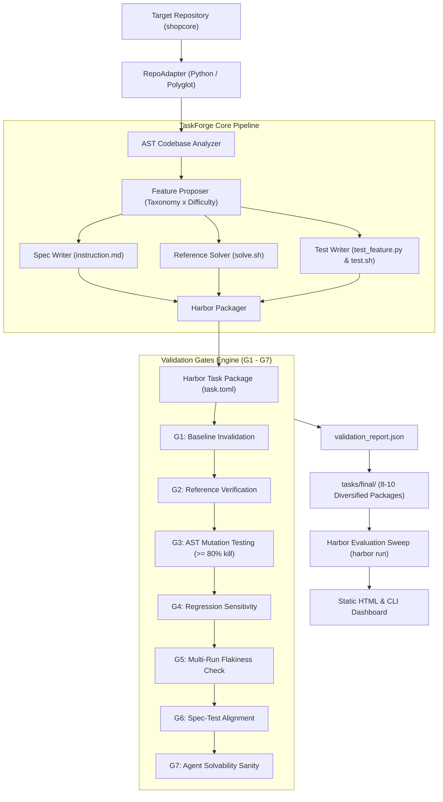

# TaskForge Architecture

## Overview
TaskForge is an automated, rigorous coding task factory designed for the Innodata Frontier AI Hackathon (Track 1). It takes any working software repository and generates realistic, multi-difficulty feature-development benchmark tasks packaged in the official **Harbor** task format.

Every task includes:
1. Complete behavior-focused `instruction.md` without solution leakage
2. Canonical reference solution applied via `solution/solve.sh`
3. Dual-layer test harness: `tests/test_feature.py` for feature requirements and repo-wide regression verification in `tests/test.sh`
4. Strict containerized verification evidence (`validation_report.json`) across 7 distinct gates (G1 through G7)

---

## System Architecture Diagram

---

## Core Components

### 1. Repository Adapter (`taskforge.adapters`)
Decouples repository specifics (commit hashing, module indexing, test runner execution) behind an abstract interface (`RepoAdapter`). The included `PythonAdapter` fully discovers AST trees, module dependencies, and test targets.

### 2. AST Codebase Analyzer (`taskforge.analyzer`)
Parses target source files into abstract syntax trees without execution. Extracts class structures, method signatures, parameter names, docstrings, imports, and cross-module dependency links.

### 3. Feature Proposer (`taskforge.proposer`)
Maintains a 3D coverage matrix (`Taxonomy x Difficulty x Module`). Rejects near-duplicates using signature similarity. Ensures meaningful variation across 8 distinct feature classes:
- New endpoint/function
- Validation rule
- Config-driven behavior
- CLI option
- Cross-module change
- Edge-case policy
- Refactor-then-extend
- Error-handling policy

### 4. Spec Writer & Reference Solver (`taskforge.spec_writer`, `taskforge.solver`)
Generates actionable requirements in `instruction.md` detailing public signatures and behavioral specifications without leaking implementation details. Concurrently generates minimal, senior-engineer reference implementations exported as patch scripts in `solution/solve.sh`.

### 5. Harbor Packager (`taskforge.packager`)
Builds standard Harbor task structures conforming to Harbor v1.4 schema, complete with `task.toml`, `environment/Dockerfile`, starting repository version snapshot, and verification runner.
