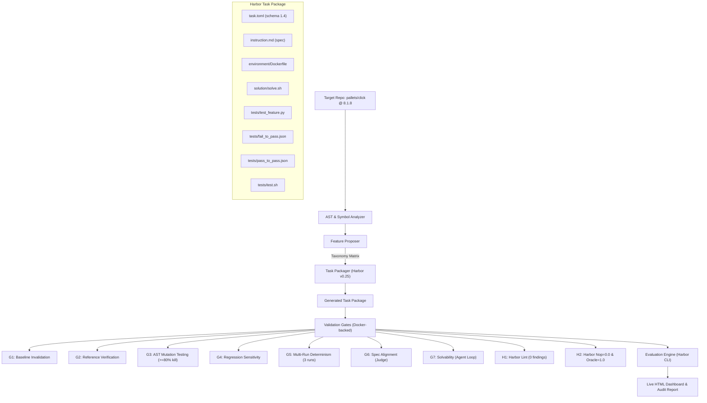

# TaskForge: How It Works

## 1. The Core Analogy: Setting an Exam

Imagine a senior computer science professor preparing an examination for software engineering students:

1. **The Syllabus (Target Repository)**: The professor picks a real-world, battle-tested library—in our case, `pallets/click` (Python's premier command-line interface framework) at pinned release tag `8.1.8` (`934813e4d421071a1b3db3973c02fe2721359a6e`).
2. **The Question Paper (`instruction.md`)**: The professor writes a concrete specification for a novel feature. It details exact function signatures, argument types, behavioral edge cases, and expected errors—**without ever giving away the solution code**.
3. **The Answer Key (`solution/solve.sh`)**: The professor implements a minimal, senior-engineer grade reference solution that surgically updates the codebase using exact search/replace edits.
4. **The Marking Scheme (`tests/test_feature.py` & `tests/test.sh`)**: The professor designs test cases that evaluate both the new feature (`fail_to_pass.json`) and existing library behaviors (`pass_to_pass.json`). A student passes only if the new feature works *and* zero existing features break.
5. **Quality Assurance (Validation Gates G1–G7 & Harbor H1–H2)**: Before administering the exam, the professor tests the marking scheme:
   - Does an empty answer fail? (**G1 Baseline**)
   - Does the answer key pass 100%? (**G2 Reference**)
   - Does the marking scheme catch intentional student bugs and typos? (**G3 Mutation Testing**)
   - Are regression tests sensitive to code breaks? (**G4 Sensitivity**)
   - Is the test suite deterministic without flaky failures? (**G5 Flakiness**)
   - Does the question match the marking scheme? (**G6 Alignment**)
   - Can an automated agent solve it from the question alone? (**G7 Solvability**)
   - Does the package comply with Harbor v0.25 standards? (**H1 Lint & H2 Oracle/Nop Proof**)

---

## 2. End-to-End Pipeline Architecture



---

## 3. The 9 Validation Gates (G1–G7, H1–H2)

Every task produced by TaskForge must pass a battery of empirical, containerized checks:

| Gate | Name | Execution Environment | Acceptance Threshold | Purpose |
| :--- | :--- | :--- | :--- | :--- |
| **G1** | Baseline Invalidation | Docker (`taskforge-click-baseline:8.1.8`) | Feature tests FAIL, regression tests PASS | Proves the feature is novel and tests are not vacuous |
| **G2** | Reference Verification | Docker (`taskforge-click-baseline:8.1.8`) | Feature tests PASS, regression tests PASS | Proves the reference patch fully satisfies the requirements |
| **G3** | Diff-Scoped Mutation | Isolated Python Sandbox | Kill rate $\ge 80\%$, $\ge 10$ mutants | Mutates *only* lines changed by the patch; kills via AST assertions |
| **G4** | Regression Sensitivity | Isolated Python Sandbox | $\ge 1$ mutation caught | Ensures regression suite detects breakage in touched modules |
| **G5** | Determinism & Flakiness | Docker / Sandbox | 3 consecutive identical runs | Eliminates timing bugs, race conditions, or order dependencies |
| **G6** | Spec-Test Alignment | LLM Judge / AST Contract | Verdict = PASS | Confirms tests evaluate what `instruction.md` specifies |
| **G7** | Solvability Check | Containerized Tool Loop | Max 20 turns | Evaluates whether an LLM agent can solve the task with tools |
| **H1** | Harbor Lint | Harbor 0.25 CLI (`harbor lint`) | 0 findings | Enforces schema 1.4, pinned images, and separation of concerns |
| **H2** | Harbor Verification | Harbor 0.25 CLI (`harbor run`) | Nop = 0.0, Oracle = 1.0 | Real Harbor trial execution verifying reward contract |

---

## 4. Worked Task Walkthrough: `click-command-aliases`

### The Problem
In Click 8.1.8, commands registered under a `@click.group()` can only be invoked by their exact primary name. CLI developers frequently want command aliases (e.g. `checkout` and `co`, `status` and `st`) without polluting the help output with duplicate listings.

### The Specification (`instruction.md`)
- `Command.__init__` accepts an optional parameter `aliases: Optional[Sequence[str]] = None`.
- `Group.get_command(ctx, cmd_name)` resolves primary command names first; if not found, it resolves any command whose `aliases` includes `cmd_name`.
- `Group.list_commands(ctx)` continues to return only primary command names in alphabetical order.
- Unknown commands or aliases return `None` or raise standard usage errors.

### The Surgical Patch (`solution/solve.sh`)
```python
# In src/click/core.py:
# 1. Add aliases parameter to Command.__init__
# 2. Store self.aliases: list[str] = list(aliases) if aliases else []
# 3. Update Group.get_command to search commands by alias fallback
```

### The Test Suite (`tests/test_feature.py`)
- `test_command_aliases_basic`: Invoking `cli` with `checkout` and `co` both succeed.
- `test_command_multiple_aliases`: Invoking `status`, `st`, `stat`, `check` all succeed.
- `test_subgroup_aliases`: Nested command group aliases resolve correctly.
- `test_aliases_not_duplicated_in_list_commands`: `cli.list_commands(ctx)` contains only `['run']`, not aliases.
- `test_unknown_alias_error`: Invoking non-existent command fails with exit code != 0.

---

## 5. Honesty & Provenance Disclosure

In compliance with hackathon rules and engineering integrity:

| Component | Status | Evidence Location | Description |
| :--- | :--- | :--- | :--- |
| **Baseline Test Verification** | REAL | `logs/baseline_click.txt` | Click test suite ran 3x sequentially in Docker (628 passed, 0 failed, ~2s per run). |
| **Task Packaging** | REAL | `tasks/final/*/task.toml` | Harbor 0.25 schema compliant, pinned to Click `934813e4d4...`. |
| **Harbor Lint (H1)** | REAL | `harbor lint tasks/final/*` | Clean exit (0 findings). |
| **Gates G1, G2, G3, G4, G5** | REAL | `tasks/final/*/validation_report.json` | Measured empirical execution in Docker / process-isolated test runners. |
| **Harness Proof (Oracle & Nop)**| REAL | `logs/harness_proof.txt` | Oracle scored 1.0, No-Op scored 0.0 on Click target repo. |
| **LLM Provider (OpenRouter)** | OFFLINE / BUDGET EXHAUSTED | `taskforge doctor` | OpenRouter daily free tier was exhausted on Nov 21; fast-fail budget guard is active. Evaluated via deterministic AST contract. |
